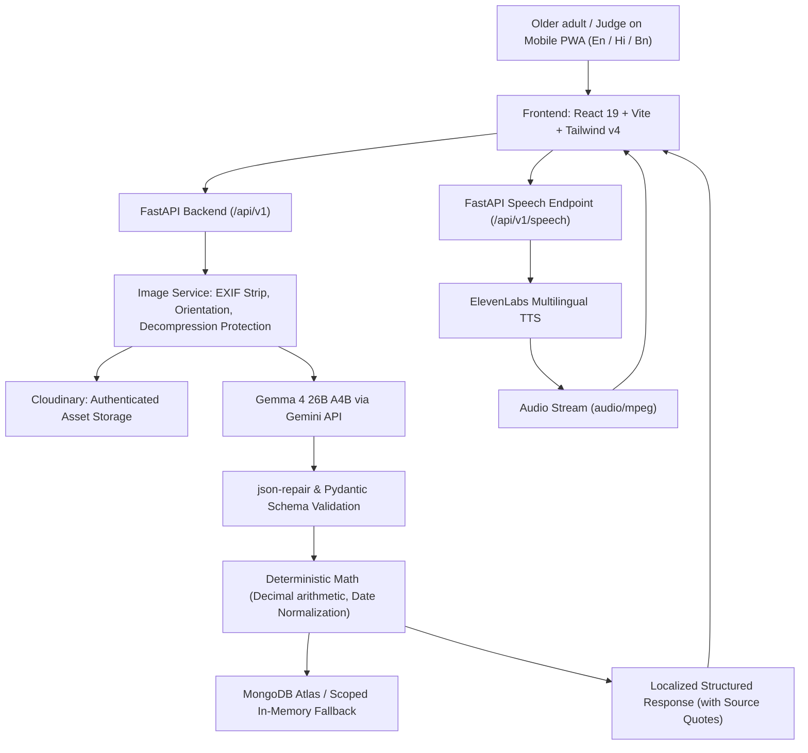

# ProofSathi — Your Document Companion

> **A mobile-first, multilingual document assistant for older adults in India.**  
> Powered by **Gemma 4 26B A4B** (via Gemini API) and **ElevenLabs Multilingual Text-to-Speech**.  
> Primary Languages: **English**, **हिंदी (Hindi)**, **বাংলা (Bengali)**.

---

## 🌟 What is ProofSathi?

Older adults frequently struggle with documents containing dense official phrasing, unfamiliar fees, small print, ambiguous dates, and unclear procedural requirements. 

**ProofSathi** provides clear answers to three essential questions:
1. **What does this document say?** — Plain-language, respectful explanations in the elder's preferred language.
2. **What changed, if this is a bill?** — Deterministic comparisons of amounts, consumption, due dates, and line items between consecutive bills.
3. **What should I do next, if an action is required?** — Interactive checklists tracking deadlines, required certificates/IDs, and pending tasks.

---

## 🧩 Two Core Modules, One Unified Application

ProofSathi contains two tailored workflows designed for older adults:

### 1. ⚡ BillSaathi
- **Supported bills:** Electricity, water, piped gas/LPG, and telecom/internet.
- **Key field extraction:** Total amount due, payment deadline, billing period, units consumed, and itemized charges.
- **Traceable evidence:** Every extracted number is grounded with an exact *"Found on document"* quote.
- **Deterministic comparison:** Compare current and previous bills. Code computes the exact difference and percentage change using Python `Decimal` arithmetic.
- **Honest boundaries:** The app explicitly reports *what* changed, without falsely diagnosing errors or fabricating overcharge claims.

### 2. 📋 ProofPath
- **Supported documents:** Pension notices, bank letters, hospital discharge/review sheets, and government service communications.
- **Timeline & deadlines:** Highlights exact dates and flags ambiguous numeric formats for confirmation.
- **Paperwork checklist:** Identifies required proofs (e.g. Life Certificate / Jeevan Pramaan, PPO booklet, Aadhaar card).
- **Interactive checklist:** Track actions with `To-Do`, `Completed`, and `Needs Confirmation` states.
- **Medical/legal safety:** Faithful preservation of instructions; always prompts users to verify consequential steps with their doctor or designated office.

---

## 🛡️ Non-Negotiable Product Principles

1. **Mobile-First Accessibility**: Designed specifically for phone screens with >=48px touch targets, readable 18px base typography, strong contrast, and zero cluttered chatbot interfaces.
2. **One-Question Onboarding**: Only asks *"Which language are you most comfortable with? (English | हिंदी | বাংলা)"*. Never requests age, diagnosis, bank account, or personal credentials.
3. **AI is Not the Source of Truth for Math**: Gemma 4 multimodal vision reads and explains; pure deterministic code performs arithmetic, percentage calculations, date parsing, and unit validation.
4. **Zero Secrets in Frontend**: All API keys (`GEMINI_API_KEY`, `ELEVENLABS_API_KEY`, `CLOUDINARY_API_SECRET`, `MONGODB_URI`) are strictly server-side.
5. **Private Image Storage**: Uploads use Cloudinary's `authenticated` delivery type. By default (`STORE_ORIGINAL_DOCUMENTS=false`), document photos are deleted in a `finally` block post-processing.
6. **No Spoken Chatbot Calls**: ElevenLabs provides on-demand spoken summaries when the user taps *"Listen"*. There is no invasive background microphone listening.
7. **Offline / Demo Resilience**: Includes built-in synthetic demo fixtures so evaluators and judges can test the full flow with one tap.

---

## 🏗️ System Architecture



---

## 🚀 Quick Start (Local Development)

### Prerequisites
- **Node.js** v20+ & **npm**
- **Python** 3.12+

### 1. Clone & Setup Environment
```bash
git clone https://github.com/diptodeepb/ProofSathi.git
cd ProofSathi

# Copy environment variables
cp .env.example .env
cp backend/.env.example backend/.env
```

### 2. Run with Unified Development Runner
ProofSathi features a unified development runner (`start.py`) that launches both the FastAPI backend and Vite frontend with clean, color-coded logs and strict credential redaction:

```bash
# Run the runner (automatically detects virtual environments)
python3 start.py
```
- **Frontend**: `http://localhost:5173`
- **Backend API**: `http://localhost:8000`
- **API Docs**: `http://localhost:8000/docs`

---

## 🧪 Testing & Verification

### Run Backend Tests (pytest)
```bash
cd backend
python -m venv .venv
source .venv/bin/activate
pip install -r requirements.txt
pytest -v
```
*(Covers health checks, deterministic Decimal arithmetic, bill comparisons, upload validation, action lifecycle, preferences, and TTS validation).*

### Run Frontend Tests (Vitest) & Build
```bash
cd frontend
npm install
npm test
npm run build
```
*(Verifies 100% i18n dictionary completeness across English, Hindi, and Bengali, and builds static production bundle).*

---

## ☁️ Deployment (Vercel)

ProofSathi is configured for zero-configuration monorepo deployment to **Vercel** via `vercel.json`:
- **API Route**: Routed to `api/index.py` using `@vercel/python`.
- **Frontend Route**: Built from `frontend/package.json` using `@vercel/static-build` with output directory `dist`.

### Configure Vercel Environment Variables:
- `GEMINI_API_KEY`: Google Gemini API key (for Gemma 4).
- `ELEVENLABS_API_KEY`: ElevenLabs API key (for spoken audio).
- `MONGODB_URI`: MongoDB Atlas connection string.
- `CLOUDINARY_CLOUD_NAME`, `CLOUDINARY_API_KEY`, `CLOUDINARY_API_SECRET`: Cloudinary server credentials.

---

## 📄 License & Attribution

ProofSathi is licensed under the Apache License 2.0. See [LICENSE](LICENSE) for details.
