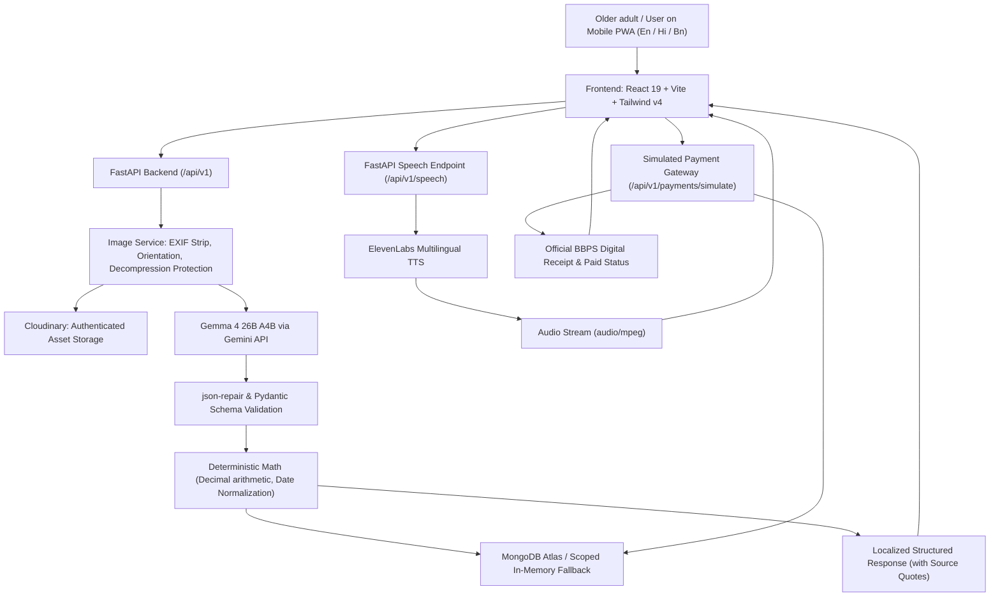

# ProofSathi — Your Document Companion

> **A mobile-first, multilingual document assistant and bill payment companion for older adults in India.**  
> Powered by **Gemma 4 26B A4B** (via Gemini API) and **ElevenLabs Multilingual Text-to-Speech**.  
> Primary Languages: **English**, **हिंदी (Hindi)**, **বাংলা (Bengali)**.

---

## 🌟 What is ProofSathi?

Older adults frequently struggle with documents containing dense official phrasing, unfamiliar fees, small print, ambiguous dates, and unclear procedural requirements.

**ProofSathi** provides clear answers to four essential questions:

1. **What does this document say?** — Plain-language, respectful explanations in the elder's preferred language.
2. **What changed, if this is a bill?** — Deterministic comparisons of amounts, consumption, due dates, and line items between consecutive bills.
3. **What should I do next, if an action is required?** — Interactive checklists tracking deadlines, required certificates/IDs, and pending tasks.
4. **How do I review and pay safely?** — Pre-filled, elder-friendly simulated payment gateway that allows senior citizens to directly review extracted bill/fee details and simulate an instant, secure payment without confusion.

---

## 🧩 Core Modules & Features

ProofSathi contains three tailored workflows designed for older adults:

### 1. ⚡ BillSaathi (Understand a Bill)

- **Supported bills:** Electricity, water, piped gas/LPG, and telecom/internet.
- **Key field extraction:** Total amount due, payment deadline, billing period, units consumed, and itemized charges.
- **Traceable evidence:** Every extracted number is grounded with an exact _"Found on document"_ quote.
- **Deterministic comparison:** Compare current and previous bills. Code computes the exact difference and percentage change using Python `Decimal` arithmetic.
- **Honest boundaries:** The app explicitly reports _what_ changed, without falsely diagnosing errors or fabricating overcharge claims.

### 2. 📋 ProofPath (Understand a Document)

- **Supported documents:** Pension notices, bank letters, hospital discharge/review sheets, and government service communications.
- **Timeline & deadlines:** Highlights exact dates and flags ambiguous numeric formats for confirmation.
- **Paperwork checklist:** Identifies required proofs (e.g. Life Certificate / Jeevan Pramaan, PPO booklet, Aadhaar card).
- **Interactive checklist:** Track actions with `To-Do`, `Completed`, and `Needs Confirmation` states.
- **Medical/legal safety:** Faithful preservation of instructions; always prompts users to verify consequential steps with their doctor or designated office.

### 3. 💳 Senior-Friendly Payment Gateway Simulation (Bharat BillPay / BBPS)

- **Direct 1-Tap "Continue to Payment":** Available on bills and official notices immediately after document processing.
- **100% Pre-Filled from Extracted JSON:** Biller name, Consumer / Reference ID, Due Date, itemized charges, and Total Amount Due are automatically populated directly from the parsed document data.
- **Senior Accessibility:**
  - High-contrast, large-print typography (>=24px headers, >=48px amounts).
  - Voice Read-Aloud: Tap the speaker icon to hear the payment summary read aloud in English, Hindi, or Bengali.
  - Multi-payment options: **UPI / QR Code** (Google Pay, PhonePe, Paytm, BHIM), **RuPay Senior Citizen Debit Card**, **Net Banking** (SBI, HDFC, ICICI, PNB), and **Senior 1-Tap Quick Pay**.
- **Realistic Banking Handshake:** Authentic 3-step simulated authorization animation (NPCI/BBPS connection → Biller verification → Bank settlement).
- **Official Digital Receipt:** Printable confirmation card with BBPS transaction reference number, biller acknowledgment, and automatic status update marking the record as `Paid` across the app.

---

## 🛡️ Non-Negotiable Product Principles

1. **Mobile-First Accessibility**: Designed specifically for phone screens with >=48px touch targets, readable 18px base typography, strong contrast, and zero cluttered chatbot interfaces.
2. **One-Question Onboarding**: Only asks _"Which language are you most comfortable with? (English | हिंदी | বাংলা)"_. Never requests age, diagnosis, bank account, or personal credentials.
3. **AI is Not the Source of Truth for Math**: Gemma 4 multimodal vision reads and explains; pure deterministic code performs arithmetic, percentage calculations, date parsing, and unit validation.
4. **Zero Secrets in Frontend**: All API keys (`GEMINI_API_KEY`, `ELEVENLABS_API_KEY`, `CLOUDINARY_API_SECRET`, `MONGODB_URI`) are strictly server-side.
5. **Private Image Storage**: Uploads use Cloudinary's `authenticated` delivery type. By default (`STORE_ORIGINAL_DOCUMENTS=false`), document photos are deleted in a `finally` block post-processing.
6. **No Spoken Chatbot Calls**: ElevenLabs provides on-demand spoken summaries when the user taps _"Listen"_. There is no invasive background microphone listening.
7. **Offline / Demo Resilience**: Includes built-in synthetic demo fixtures so evaluators and judges can test the full flow with one tap.

---

## 🏗️ System Architecture



---

## 🔌 API Endpoints Summary

| Method   | Endpoint                           | Description                                                      |
| -------- | ---------------------------------- | ---------------------------------------------------------------- |
| `GET`    | `/api/v1/health`                   | Service health status                                            |
| `POST`   | `/api/v1/documents/analyze`        | Upload and analyze a bill or notice (multipart image)            |
| `GET`    | `/api/v1/documents`                | List session documents with summaries and warnings               |
| `GET`    | `/api/v1/documents/{id}`           | Retrieve parsed document fields and action items                 |
| `DELETE` | `/api/v1/documents/{id}`           | Delete a document from records                                   |
| `POST`   | `/api/v1/bills/compare`            | Deterministically compare two bills using Python `Decimal`       |
| `GET`    | `/api/v1/actions`                  | Retrieve action items for a document or session                  |
| `POST`   | `/api/v1/actions`                  | Create a custom action item                                      |
| `PATCH`  | `/api/v1/actions/{id}`             | Update action status (`pending`, `completed`, etc.)              |
| `POST`   | `/api/v1/speech`                   | Generate ElevenLabs speech narration for text                    |
| `GET`    | `/api/v1/demo/fixtures`            | List built-in demo fixtures                                      |
| `GET`    | `/api/v1/demo/fixtures/{id}/image` | Fetch demo fixture image bytes                                   |
| `POST`   | `/api/v1/payments/simulate`        | Execute simulated BBPS transaction with pre-filled document data |
| `GET`    | `/api/v1/payments/{document_id}`   | Retrieve payment receipt for a document                          |

---

## 🚀 Quick Start (Local Development)

### Prerequisites

- **Node.js** v20+ & **npm**
- **Python** 3.12+

### 1. Clone & Setup Environment

```bash
git clone https://github.com/diptodeepb/ProofSathi.git
cd ProofSathi

# Copy environment variables
cp .env.example .env
cp backend/.env.example backend/.env
```

### 2. Run with Unified Development Runner

ProofSathi features a unified development runner (`start.py`) that launches both the FastAPI backend and Vite frontend with clean, color-coded logs and strict credential redaction:

```bash
# Run the runner (automatically detects virtual environments)
python3 start.py
```

- **Frontend**: `http://localhost:5173`
- **Backend API**: `http://localhost:8000`
- **API Docs**: `http://localhost:8000/docs`

---

## 🧪 Testing & Verification

### Run Backend Tests (pytest)

```bash
cd backend
python -m venv .venv
source .venv/bin/activate
pip install -r requirements.txt
pytest -v
```

_(Covers health checks, deterministic Decimal arithmetic, bill comparisons, upload validation, action lifecycle, preferences, payment simulation, and TTS validation)._

### Run Frontend Tests (Vitest) & Build

```bash
cd frontend
npm install
npm test
npm run build
```

_(Verifies 100% i18n dictionary completeness across English, Hindi, and Bengali, and builds static production bundle)._

---

## ☁️ Deployment (Vercel)

ProofSathi can be deployed on Vercel either as **two independent services** (Frontend + Backend) or as a **unified monorepo**.

### Option A: Separate Deployments (Recommended)

1. **Backend Project (`proofsathi-backend`)**:
   - In Vercel Project Settings, set **Root Directory** to `backend`.
   - Vercel uses `backend/vercel.json` and `backend/api/index.py` with `@vercel/python`.
   - Configure Environment Variables in the Vercel Dashboard:
     - `GEMINI_API_KEY`: Google Gemini API key (for Gemma 4).
     - `FRONTEND_ORIGIN`: `https://proofsathi.vercel.app` (CORS).
     - `MONGODB_URI`: _(Optional)_ MongoDB Atlas connection string.
     - `CLOUDINARY_*` / `ELEVENLABS_*`: _(Optional)_ Server credentials.
2. **Frontend Project (`proofsathi`)**:
   - In Vercel Project Settings, set **Root Directory** to `frontend`.
   - Vercel uses `frontend/vercel.json` for client-side routing.
   - Configure Environment Variable in the Vercel Dashboard:
     - `VITE_API_BASE_URL`: `https://proofsathi-backend.vercel.app/api/v1`
   - _Note: Remember to redeploy the frontend after setting `VITE_API_BASE_URL` so Vite bakes it into the build._

### Option B: Monorepo Deployment

Deploy directly from repository root using the root `vercel.json`:

- **API Route**: Routed to `api/index.py` using `@vercel/python`.
- **Frontend Route**: Built from `frontend/package.json` with output directory `dist`.

> [!NOTE]
> Vercel ignores local `.env` files committed to git in production. Always configure your keys securely in the **Vercel Web Dashboard** under **Project Settings → Environment Variables**.

---

## 📄 License & Attribution

ProofSathi is licensed under the Apache License 2.0. See [LICENSE](LICENSE) for details.
