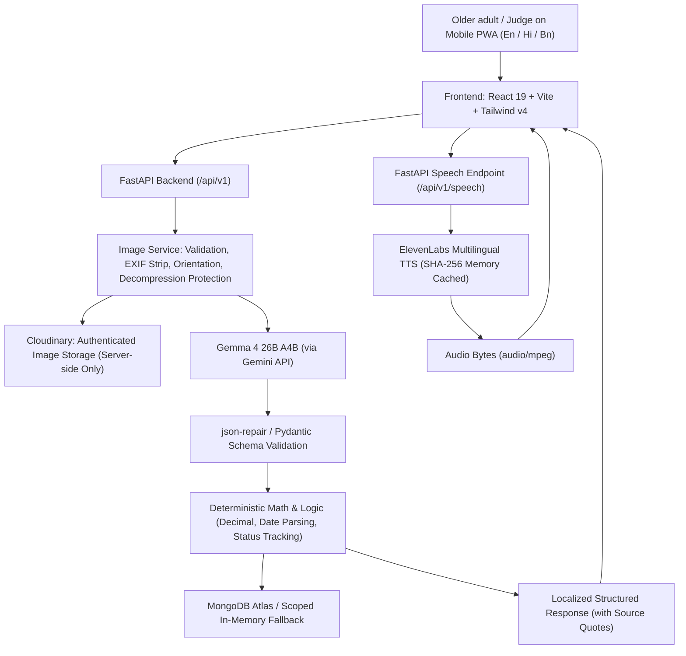

# ProofSathi — Technical Architecture

## 1. System Overview

ProofSathi is a mobile-first, multilingual document assistant designed specifically for older adults in India. It bridges the gap between complex official documents and actionable understanding across three primary languages: English, Hindi, and Bengali.

ProofSathi is organized into two core workflows:
1. **BillSaathi**: Interprets electricity, water, gas, and telecom bills, providing plain-language explanations, extraction of key financial fields with traceable source evidence, and deterministic mathematical comparisons with earlier bills.
2. **ProofPath**: Interprets pension notices, bank letters, hospital discharge/follow-up instructions, and government service communications, extracting critical deadlines, required paperwork, and next steps into an accessible, toggleable checklist.

---

## 2. Architectural Blueprint

---

## 3. Core Architectural Decisions

### 3.1 AI is Never the Source of Truth for Arithmetic
- LLMs are prone to arithmetic errors and hallucinated fees.
- In ProofSathi, **Gemma 4 26B A4B** extracts visual text and generates plain-language phrasing.
- **Python's `Decimal` module** deterministically computes all monetary differences, percentage changes, and consumption deltas.
- If a prior bill's amount is zero, percentage change is returned as `null` rather than a nonsensical mathematical division by zero.
- The system explicitly distinguishes observed numeric differences from inferred causes.

### 3.2 Security, Privacy, and Asset Delivery
- **Zero Secrets on Client**: `GEMINI_API_KEY`, `ELEVENLABS_API_KEY`, `MONGODB_URI`, and `CLOUDINARY_API_SECRET` are strictly held on the server.
- **Authenticated Image Delivery**: Document uploads use Cloudinary's `authenticated` delivery type. Default public image uploads are never used for sensitive bills, bank letters, or medical documents.
- **Immediate Cleanup by Default**: Unless the user explicitly enables persistent document storage (`STORE_ORIGINAL_DOCUMENTS=true`), temporary Cloudinary assets are deleted in a `finally` block post-analysis.

### 3.3 Offline / Demo Resilience
- ProofSathi includes a synthetic demo specimen generator (`demo-electricity-current`, `demo-electricity-previous`, `demo-pension-notice`, `demo-hospital-followup`, `demo-blurry-bill`).
- If an external API key is unset or external quota is rate-limited (429), the system degrades gracefully with high-fidelity deterministic fixtures so evaluators and judges can always test the end-to-end flow.

---

## 4. Technology Stack Summary

| Layer | Technology | Rationale |
|---|---|---|
| **Frontend** | React 19, TypeScript, Vite, Tailwind CSS v4, Lucide | Fast, accessible, mobile-first PWA with >=48px touch targets |
| **Backend** | Python 3.12+, FastAPI, Uvicorn, Pydantic v2 | High-performance async API with strict contract validation |
| **AI Vision & Extraction** | `gemma-4-26b-a4b-it` via Gemini API (`google-genai`) | Multimodal document comprehension tuned for Indian documents |
| **Voice Synthesis** | ElevenLabs Text-to-Speech API (`eleven_multilingual_v2`) | High-clarity spoken audio in English, Hindi, and Bengali |
| **Database** | MongoDB Atlas (Motor async driver) | Scoped document, action checklist, and preference persistence |
| **Image Storage** | Cloudinary (Authenticated Delivery) | Private, signed image asset storage with automatic cleanup |
| **Deployment** | Vercel (Frontend static build + Serverless Python Function) | Unified repository deployment via `vercel.json` |
